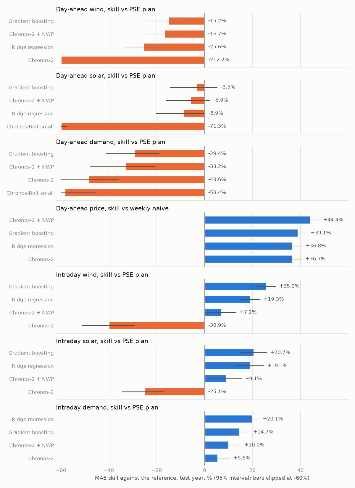

# pl-forecast-bench

[](https://github.com/kwwaleszczynski-del/pl-forecast-bench/actions/workflows/ci.yml)

A **citable benchmark of forecasts for the Polish power system**: national wind generation, solar generation, power
demand and the SDAC day-ahead price, **day-ahead** (issued on D-1 at 10:00, before the SDAC gate closure) and
**intraday** (1 to 6 hours ahead), at **15-minute** resolution. It fixes the data, the splits, the metrics and a set
of reference models, from naive forecasts and the official PSE plan to gradient boosting and zero-shot time series
foundation models, and it enforces one rule above all others: **a model sees only what was public at the moment of
the forecast**. Tests break if any feature or forecast changes when the future is replaced by noise.

**Leaderboard:** https://kwwaleszczynski-del.github.io/pl-forecast-bench/

## Results (test year, 1 October 2025 to 30 September 2026)



- **Day-ahead, the PSE plan stays ahead for volumes, but it is not a fair race.** No model that respects the
  10:00 issue time beats the PSE day-ahead plan, which is published after the gate (13:30-20:30 on D-1) with
  fresher weather and the market results. Best as-of models: wind 462 MW MAE against 401 MW (skill -15%, 95%
  interval -24 to -7%), solar 352 against 340 MW (-3.5%, -14 to +5%: no significant difference), demand 536 against
  414 MW (-29%), all gradient boosting on ECMWF features.
- **Intraday, the plan is beaten by 20-26%.** With the newest actuals (public an hour after each quarter-hour) and
  the plan itself as inputs: wind 297 MW (+25.9%), solar 270 MW (+20.7%), demand 331 MW with ridge (+20.1%). The
  gain is largest one hour ahead (wind 277 MW) and shrinks towards six hours (311 MW); the plan does not change
  within the day (401 MW at every lead).
- **The day-ahead price is the one task a zero-shot foundation model wins.** Chronos-2 with the ECMWF wind, solar
  and temperature indices as covariates reaches 88.5 PLN/MWh MAE, 44% better than the price a week earlier and 9%
  better than gradient boosting (97.1). For the battery the difference almost vanishes: 83.1% against 82.7% of the
  perfect-foresight profit (337 and 336 thousand PLN/MW/year), so a lower MAE does not translate one to one into
  value.
- **Foundation models need the weather.** Univariate Chronos-Bolt, Chronos-2, TimesFM 2.5 and Toto forecast
  day-ahead wind with 1,250-1,290 MW MAE, three times worse than with NWP (468 MW for Chronos-2 with covariates).
  Without covariates they are competitive only for the price (Chronos-2 100.8 PLN/MWh, as good as ridge) and
  demand.
- **Calibration.** The decile models of gradient boosting are too sharp day-ahead: the 10-90% interval holds 59%
  of the wind and demand outcomes and 60% of prices; Chronos-2 with covariates holds 81%, 72% and 71%.
- **Imbalance cost** (simplified settlement, see Metrics): day-ahead wind 6.8 PLN/MWh for the best model against
  5.4 for the PSE plan, demand 1.3 against 1.8; for solar the plan's deviations earned money on average (-3.5) while
  the best model's cost 15.2 PLN/MWh, a reminder that the value of an error depends on when it happens.

MAE per task (MW; price in PLN/MWh). Bold: best model that respects the as-of rule; * not ranked (published after
the origin):

| model | DA wind | DA solar | DA demand | DA price | ID wind | ID solar | ID demand |
|---|---:|---:|---:|---:|---:|---:|---:|
| Persistence | 1,513 | 3,560 | 2,774 | 180.1 | 704 | 2,718 | 2,254 |
| Seasonal naive, day | 1,534 | 700 | 1,822 | 133.2 | 1,352 | 595 | 1,352 |
| Seasonal naive, week | 1,892 | 817 | 1,063 | 159.3 | 1,893 | 817 | 1,063 |
| PSE plan (PKD) | 401* | 340* | 414* | - | 401 | 340 | 414 |
| Ridge regression | 503 | 371 | 713 | 100.7 | 323 | 275 | **331** |
| Gradient boosting | **462** | **352** | **536** | 97.1 | **297** | **270** | 353 |
| Chronos-Bolt small | 1,290 | 583 | 656 | 105.7 | 579 | 477 | 470 |
| Chronos-2 | 1,251 | 608 | 615 | 100.8 | 561 | 426 | 391 |
| Chronos-2 + NWP | 468 | 360 | 551 | **88.5** | 372 | 310 | 373 |
| TimesFM 2.5 | 1,274 | 629 | 749 | 109.8 | 602 | 453 | 421 |
| Toto | 1,272 | 606 | 723 | 107.0 | 609 | 514 | 602 |

Toto's horizon here fits in one output patch, so all its samples come from one predictive distribution: they are
drawn from a single forward pass (checked against the library's own sampler, which reruns the context for every
sample: the same deciles within sampling noise, about 2,500 times faster intraday), and its point forecast is the
sample median. All scores, by lead time, hour and month, are in `submissions/*/` and on the
[leaderboard](https://kwwaleszczynski-del.github.io/pl-forecast-bench/).

## Live track

Benchmark v1 is frozen. Next to it, a monthly job (`.github/workflows/live.yml`) forecasts every new month with the
reference models that run on a CPU (persistence, seasonal naive, PSE plan, ridge, gradient boosting), with the same
tasks, as-of rules and metrics, and adds the scores to `docs/live/` and to the site. It differs from v1 in three ways:

- the models are refitted once a month, at its first midnight, on the previous 12 months (a rolling window, so the
  job downloads about 13 months of weather, some 3,300 Open-Meteo units, instead of the whole history);
- foundation models are not included (no GPU in the runner);
- the imbalance cost of the newest month is preliminary, because PSE corrects imbalance prices for about 45 days.

Live months are therefore not part of v1 and not comparable one to one with the test-year leaderboard. The job runs
on the 5th of each month for the previous month only when the repository variable `DASHBOARD_SCHEDULE` is `on` (it
is off by default); a manual run (`workflow_dispatch`, optional month) always works. Locally:
`python -m plfb live --month 2026-10`.

## Tasks

| track | variables | origin | targets | rows in the test year |
|---|---|---|---|---:|
| day-ahead | wind, PV, demand, price | D-1 10:00 Polish time | every quarter-hour of D (92/96/100) | 35,040 per variable |
| intraday | wind, PV, demand | every full hour | quarter-hours starting 60 to 345 min later (20) | 175,200 per variable |

- **Targets:** PSE `his-wlk-cal` (`wi`, `pv`, `demand`, MW; wind and PV include units outside the balancing market),
  PSE `csdac-pln` (SDAC clearing price of the Polish bidding zone, PLN/MWh).
- **Resolution:** everything is forecast and scored per quarter-hour. The price was an hourly product until 30
  September 2025 (the four quarter-hours of an hour carry the same price in the training data); the test year is
  entirely 15-minute products. The weather input is hourly (ECMWF IFS through Open-Meteo) and is interpolated to
  quarter-hours: instantaneous variables linearly, irradiance (a mean of the preceding hour) with the shape of the
  clear-sky irradiance inside the hour, keeping the hourly mean.
- **No intraday price task:** the day-ahead price of D is published on D-1 afternoon.
- **Splits** (Polish business days): train 21 June 2024 to 30 June 2025, validation July to September 2025,
  **test 1 October 2025 to 30 September 2026**. Day-ahead rows belong to the split of their delivery day, intraday
  rows to the split of the local date of their origin. A model may be refitted at any origin on data public at that
  origin; the reference models are refitted at the start of every quarter on an expanding window.

## The as-of rule

| input | public from | how it was set |
|---|---|---|
| actual wind, PV, demand (`his-wlk-cal`) | interval end + 60 min | the real-time feed ran 37 minutes behind the end of the interval on 28 October 2026 (published at hh:07, :22, :37, :52) |
| SDAC price (`csdac-pln`) | publication time of its business day reported by the API | D-1 13:30-14:45 local in most days, latest 18:00 |
| PSE day-ahead plan (`pdgopkd`) | publication time reported by the API | D-1 15:30-16:30 local in most days, latest 20:30 |
| ECMWF IFS run (Open-Meteo Single Runs API) | initialisation + 7 h | Open-Meteo states 4-6 hours for global models |

Consequences:

- The day-ahead forecast for D sees the 00 UTC weather run of D-1 (lead 22 to 47 hours) and actuals up to D-1
  09:00. The intraday forecast sees the newest 00 UTC run (from 07 UTC on) and actuals up to one hour before the
  origin.
- **Weather is an archived forecast, never a reanalysis.** ERA5 is built after the fact from observations, so using
  it as an input leaks the future (it would make a day-ahead wind forecast look far better than possible). The
  Open-Meteo Single Runs API returns each ECMWF IFS HRES run as it was issued (archived from March 2024).
- **The PSE plan is not public at the day-ahead origin.** PKD for D is published after the SDAC gate (13:30-20:30 on
  D-1), with fresher weather and the market results. Day-ahead it is shown as a reference for skill but not ranked;
  intraday it is as of the origin, ranked, and used as an input by the intraday models.
- The actuals are the values as finally published (PSE republishes the day after and corrects later); the values
  seen in real time can differ slightly.

`src/plfb/asof.py` is the only path from the data to the models: every lookup takes an origin and returns NaN for
anything published after it. `tests/test_leakage.py` replaces everything not yet public at an origin with noise and
requires identical features (all seven tasks, synthetic and real data), identical foundation-model contexts and
weather covariates, and identical refitted models; it also checks the weather run chosen for each origin, the
observation lag and that the day-ahead PSE plan is never public at the origin. The submission checker refuses
forecasts whose origin differs from the task grid (for example a day-ahead forecast "issued" after the gate).

## Metrics

Point: MAE, RMSE and nMAE. For wind and PV nMAE divides each error by the installed capacity at that time
($`\mathrm{nMAE} = \frac{1}{N}\sum_t |y_t - \hat y_t| / C_t`$, capacity interpolated between dated values from
Forum Energii, URE and PSE, `benchmark/capacity.toml`; never a model input); for demand by the mean demand, for the
price by the mean absolute price.

Probabilistic (optional, nine deciles $`\tau = 0.1, \dots, 0.9`$): pinball loss and CRPS approximated on the
deciles,

```math
\mathrm{CRPS} \approx \frac{2}{9} \sum_{\tau} \frac{1}{N} \sum_t \rho_\tau\left(y_t - \hat q_{\tau,t}\right),
\qquad \rho_\tau(u) = \max(\tau u, (\tau - 1) u),
```

plus coverage and width of the 10-90% interval.

Skill: $`1 - \mathrm{MAE}/\mathrm{MAE}_{\mathrm{ref}}`$ on the rows both forecasts have, with a 95% interval from a
bootstrap over delivery days. The reference is the PSE plan for wind, PV and demand and the weekly naive forecast for
the price.

Value (simplified, the settlement and market rules quoted here should be verified before any practical use):

- **Imbalance cost** (day-ahead wind, PV, demand): the forecast volume is traded at the SDAC price $`p_t`$ and the
  deviation settled at the single imbalance price CEN $`c_t`$ (PSE `crb-rozl`); against a perfect forecast that
  costs $`s\,(y_t - \hat y_t)(p_t - c_t)\,\Delta t`$ per quarter-hour, $`s = +1`$ for a producer and $`-1`$ for a
  supplier, reported in PLN per MWh of actual energy. National volumes are treated as one balancing position, with
  no fees and no netting.
- **Battery profit** (day-ahead price): the 1 MW / 2 MWh battery of
  [pl-bess-paper-trading](https://github.com/kwwaleszczynski-del/pl-bess-paper-trading) (MILP, 87% round trip,
  state of charge 5-95%, 30 PLN/MWh degradation, at most 1.5 cycles a day) is scheduled on the forecast prices and
  settled at the actual ones; reported as PLN/MW/year and as a share of perfect foresight.

## Reference models

| model | inputs | probabilistic |
|---|---|---|
| persistence | latest public value, held flat | errors of the previous 90 days by hour |
| seasonal naive, day / week | same quarter-hour on the newest public day / a week earlier | as above |
| PSE plan (PKD) | the operator's plan | no |
| ridge | NWP (8 points, aggregates), lags, calendar dummies; intraday also the PSE plan | errors of the previous 90 days |
| gradient boosting | as ridge, LightGBM for the mean and each decile | yes |
| Chronos-Bolt small, Chronos-2, TimesFM 2.5, Toto | the target's own history; Chronos-2 also with NWP covariates | yes |

The eight weather points stand for groups of voivodeships and carry their wind and PV capacity and population as
weights (`benchmark/points.toml`). Gradient boosting has fixed settings (LightGBM, 300 trees for the mean, 200 per
decile); a variant boosted from the ridge prediction, meant to extrapolate beyond the training range (a growing PV
fleet), was tried on the validation split and lost on 6 of 7 tasks, so the plain model is used. Intraday training
rows are thinned to origins at even hours.

Foundation models run zero-shot (no fine-tuning) on the target's own history, 2,048 quarter-hours intraday and
1,024 hourly means day-ahead (the 38-40 hour gap from the last public value to the end of D is longer than some
models forecast natively at 15 minutes; the hourly forecast is interpolated to quarter-hours). Chronos-2 is run
twice, univariate and with ECMWF covariates (the variable's NWP index and temperature), past values from each day's
previous-day run and future values from the newest run public at the origin. Licences were checked on the model
cards on 28 October 2026: Chronos-Bolt, Chronos-2, TimesFM 2.5 and Toto are Apache-2.0. Not included: Moirai 1.x
and 2.0 (CC BY-NC 4.0), TiRex (NXAI Community License) and TimesFM 3.0 (weights under a non-commercial licence).

## Reproduce and submit

Python 3.11 or newer.

```bash
python -m venv .venv
.venv/Scripts/python -m pip install -e ".[dev]"      # Linux/macOS: .venv/bin/python
python -m plfb pse          # PSE reports through pse-opendata (a few minutes)
python -m plfb nwp          # 846 archived ECMWF runs from Open-Meteo (about 2 hours, ~6,800 API units)
python -m plfb build        # canonical tables in $PLFB_DATA/bench (default ./data/bench)
python -m plfb verify       # checksums per table and month against benchmark/checksums.json
python -m pytest -q         # includes the leakage tests on your data
```

`scripts/reproduce.sh` runs everything, including the reference models (about 30 minutes on two cores). Data go
to `--data-dir`, `$PLFB_DATA` or `./data`.

**Foundation models** (optional; PyTorch and about 2.2 GB of weights, cached in `$PLFB_DATA/hf-cache`):

```bash
.venv/Scripts/python -m pip install torch --index-url https://download.pytorch.org/whl/cu126   # or the CPU wheel
.venv/Scripts/python -m pip install -e ".[foundation]"
# Toto pins old torch, numpy and pandas; its code runs with current ones when installed without them:
.venv/Scripts/python -m pip install --no-deps toto-ts==0.2.0 gluonts==0.16.2 jaxtyping rotary-embedding-torch
.venv/Scripts/python -m pip install lightning pydantic toolz
python -m plfb foundation --models chronos_bolt chronos2 chronos2_nwp timesfm toto --device cuda
```

**Submission format** (CSV or Parquet, one row per forecast):

| column | content |
|---|---|
| `track`, `variable` | `day_ahead` or `intraday`; `wind`, `pv`, `demand`, `price` |
| `origin_utc`, `target_utc` | issue time and start of the forecast quarter-hour, UTC (`2025-10-01T08:00:00Z`) |
| `point` | point forecast, MW or PLN/MWh |
| `q10` ... `q90` | optional deciles |

Rows must match the task grid exactly (`plfb.tasks.rows(track, "test")`); you may leave out whole tasks. Score and
add the result:

```bash
python -m plfb evaluate --forecast my_test.parquet --name my-model --meta meta.json --out submissions/my-model
python -m plfb leaderboard
```

Open a pull request with `submissions/my-model/meta.json` (name, description, inputs, `as_of`, code URL, authors,
licence) and `scores_test.json`, and link the forecast file and the code that produced it; CI checks the entry and
the maintainer re-scores the file. Forecasts are expected to follow the as-of rule; a submission that cannot show it
is listed as not as-of and is not ranked.

## Data and licences

- **PSE S.A.**: reports API `api.raporty.pse.pl` (`his-wlk-cal`, `csdac-pln`, `pdgopkd`, `crb-rozl`), read with
  [pse-opendata](https://github.com/kwwaleszczynski-del/pse-opendata) (pinned to a commit). PSE's conditions for
  re-using public sector information (BIP, entry changed on 14 October 2026, checked on 28 October 2026) allow
  commercial and non-commercial re-use of information published in the BIP and on www.pse.pl, with the source and
  date named, the PSE logo removed and processed information marked as such. They do not name the reports API, so
  this repository **does not redistribute PSE data**: it ships download scripts and checksums
  (`benchmark/checksums.json`, SHA-256 of a canonical text form per table and month). PSE corrects some reports for
  months (imbalance prices up to ~120 days, demand and generation usually within a day, with a mass republication of
  2024-2025 on 18 January 2026), so a later download can differ; `plfb verify` shows which months. Attribution:
  *Information obtained from PSE S.A. (www.pse.pl, api.raporty.pse.pl), state as of 28 October 2026; processed in
  whole or in part.*
- **Weather:** [Open-Meteo.com](https://open-meteo.com/) Single Runs API, CC BY 4.0; model ECMWF IFS HRES 9 km,
  ECMWF open data, CC BY 4.0. Not redistributed either (same scripts and checksums).
- **Installed capacity:** Forum Energii, "Transformacja energetyczna w Polsce. Rocznik 2026" and PSE figures quoted
  by gramwzielone.pl (`benchmark/capacity.toml`); voivodeship capacity: URE "Mapa OZE" (30 June 2026).
- **Code:** MIT.

This is an independent project, not affiliated with PSE S.A., ECMWF or Open-Meteo.

## Cite

See [CITATION.cff](CITATION.cff); the archived release and its DOI are listed there once deposited on Zenodo.

```
Waleszczyński, K. (2026). pl-forecast-bench: a leakage-checked forecasting benchmark for the Polish power system
(version 1.1.0). https://github.com/kwwaleszczynski-del/pl-forecast-bench
```

## Limitations

- National aggregates only; eight weather points; one weather model (ECMWF IFS, 00 UTC runs only, so intraday
  origins before 07 UTC use the previous day's run). The archive lacks the runs of 5-9 August 2025 (validation
  period); the run of 4 August was fetched with seven days instead of two to bridge the gap.
- The test year is one year; results for a single year depend on its weather and prices, hence the bootstrap
  intervals.
- Real-time actuals may differ from the final values used here.
- The imbalance-cost and battery metrics rest on simplified settlement rules (to be verified against current market
  rules) and are comparisons between forecasts, not estimates of anyone's cash flow.

## Layout

```
benchmark/      spec.toml (tasks, splits, availability), points.toml, capacity.toml, checksums.json
src/plfb/       pse_data, nwp (downloads), dataset (tables, checksums), asof (guarded store), tasks, features,
                metrics, evaluate, submission, leaderboard, live (monthly track),
                baselines/ (models, run, foundation)
submissions/    one folder per entry: meta.json, scores_test.json
docs/           the leaderboard site (GitHub Pages, main:/docs); docs/live/ holds the monthly live scores
tests/          leakage tests, metrics, submission checks
```
